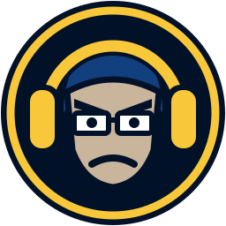
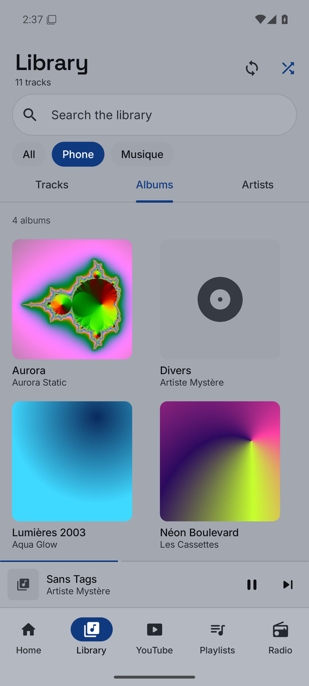

# Chud Music More

**Chud Music for Android.**
The music on your phone, on your NAS or PC, on YouTube Music and on the radio, in one app.
No ads, no account, no tracking. Free software.

[**Download**](#install) · [What it plays](#what-it-plays) · [Features](#features) · [Documentation](#documentation) · [Privacy](#privacy) · [Français](docs/fr/README.md) · [PC: Chud Music](https://github.com/BigFatDeuce/Chud-Music)

> **Languages:** English and French. Chud Music follows your phone's language.

**On Windows or Linux?** Try [**Chud Music**](https://github.com/BigFatDeuce/Chud-Music), the desktop
music player, modern and retro: your files, YouTube Music, world radio, synced lyrics, MilkDrop
visualizer, five skins. Playlists go from one to the other.

## What it plays

| Source | How |
|---|---|
| **Your phone** | MP3, FLAC, M4A/AAC, OGG/Opus, WAV, read where they are |
| **Your network** | **SMB** shares (Windows PC, NAS, Samba) and **WebDAV** (Nextcloud…), streamed, nothing copied |
| **YouTube Music** | search, albums, artists, endless mixes; audio only, no ads, no Google account |
| **Radio** | thousands of Internet stations from the free [Radio Browser](https://www.radio-browser.info) directory |

Chud Music never modifies, moves or deletes a music file, on the phone or on a share.

## Features

- **Find your shares in two taps**: *Search the network* lists the PCs and NAS on your Wi-Fi and the
  folders they share; pick one and it is in your library.
- **Home** with what you played recently, a **Random** shelf you can redraw, your playlists and
  recent additions; each shelf can be hidden, and a track or an album can be taken off it.
- **Hide a YouTube Music artist** you never want to hear: gone from searches, mixes and artist
  pages, and restorable from Settings.
- **Library scan in the background**, resumed where it stopped if Android interrupts it.
- **Player** with queue, shuffle, repeat, playback speed, a **10-band equalizer** with presets, a
  live spectrum and **synced lyrics**: the ones in your files first, otherwise from
  [LRCLIB](https://lrclib.net).
- **Track card**: format, bit rate, your plays, and links about the artist (YouTube Music,
  Wikipedia, Grokipedia, Last.fm, Discogs).
- **Playlist tools**: search inside a playlist, sort it, find duplicates (the best copy stays),
  swap YouTube Music tracks for your own files.
- **Find missing covers** on Deezer and iTunes, kept in the app, never written into your files.
- **Pause scanning** of a network share you know did not change.
- **Playlists shared with [Chud Music for PC](https://github.com/BigFatDeuce/Chud-Music)**, both ways (JSON, M3U, M3U8). Tracks are found again
  on the other device even when their paths differ.
- **Listening statistics**: time, streaks, favourite tracks, artists, albums and stations. They
  stay on the phone.
- Two skins, **Chud Nocturne** (dark) and **Platine** (light), or follow the system.
- English and French, ready for more languages.
- Lock screen, notification and Bluetooth controls; browsable from Android Auto.
- **Updates from inside the app**, only when you say so.

## Install

1. On your phone, open the [latest release](https://github.com/BigFatDeuce/Chud-Music-More/releases/latest)
   and download `ChudMusic-<version>.apk`.
2. Open the file. Android asks once to allow installing apps from your browser or file manager.
3. Later versions install from **Settings › Updates** in the app.

Android 8.0 or newer. The APK is signed; its SHA-256 is in `SHA256SUMS.txt` next to it.

## Documentation

- [User guide](docs/GUIDE.md)
- [Exchanging playlists with the PC app](docs/PC-PLAYLISTS.md)
- [Building, signing and releasing](docs/BUILDING.md)
- [What was tested, what was not, known limits](docs/TESTING.md)
- [State machines](docs/STATE-MACHINES.md) and [AGENTS.md](AGENTS.md), for contributors and coding agents

## Privacy

No account, no analytics, no advertising identifier. The app talks to the servers you add, to
YouTube Music when you use it, to Radio Browser and LRCLIB for stations and lyrics, to Deezer and
iTunes only when you ask for missing covers (the album's artist and title), and to GitHub
once a day to look for a new version (this can be switched off). Share passwords are encrypted
with a key that never leaves the phone.

## Source code and licence

Chud Music is free software under the **GNU General Public License, version 3** ([LICENSE](LICENSE)).

This repository holds the documentation and the releases. The complete source code of each
version is attached to its release as `ChudMusic-<version>-sources.zip`; it builds on its own
(see [Building](docs/BUILDING.md)).

The libraries and fonts it uses keep their own licences; their texts are in [licenses/](licenses/)
and in the app (**Settings › Licenses**).

Chud Music is not affiliated with YouTube or Google. YouTube Music tracks are streamed, never
downloaded.
